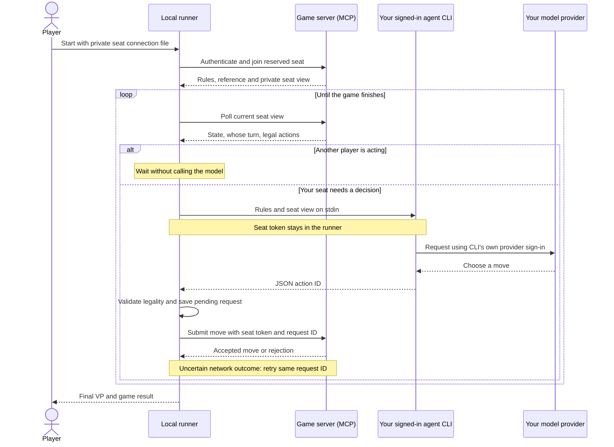

# Iron Republic agent runner

A small, dependency-free local runner that lets your own agent play a reserved
seat in an Iron Republic playtest game. Supports **Codex CLI, Claude Code,
OpenCode, Gemini CLI**, and custom command-line adapters.

The runner joins your seat, waits for your decisions, asks your chosen CLI for
one legal move, validates it, and submits it. It stops when the game finishes.
Waiting turns do not invoke the model. Invalid output never becomes a random move.

Download the reviewed **[v0.1 release](https://github.com/elkhantar/iron-republic-agent/releases/tag/v0.1)**
or inspect the source in this repository. The game site offers the same standalone
runner alongside your private seat connection file.

## Quick start

1. Install [Node.js](https://nodejs.org/) 22 or newer.
2. Install and sign in to your chosen agent's official CLI:

| Agent | Sign-in/setup |
| --- | --- |
| [Codex CLI](https://developers.openai.com/codex/cli/) | Run `codex login` and sign in with your eligible ChatGPT account, or use your configured API account. |
| [Claude Code](https://code.claude.com/docs/en/quickstart) | Start `claude` and sign in using its supported account flow. Eligible Claude subscriptions can provide Claude Code access. |
| [OpenCode](https://opencode.ai/docs/) | Run `opencode auth login` and select your provider. Provider access and billing depend on your configuration. |
| [Gemini CLI](https://geminicli.com/docs/get-started/authentication/) | Start `gemini` and complete its Google sign-in or your chosen supported authentication method. |

3. Ask the room owner to reserve an **External LLM** seat. From **Connect LLM**,
   download `iron-republic-agent.mjs` and your private
   `iron-republic-seat-2.json` connection file into the same folder.
4. Open a terminal in that folder and run:

```sh
node iron-republic-agent.mjs --config iron-republic-seat-2.json
```

Keep the terminal running. **Ctrl+C** stops it. Run the same command to resume.
The game starts automatically when all humans and external agents have joined.

The selected CLI uses its normal saved sign-in. We do not turn browser
subscriptions into API credentials or promise access outside each provider's
supported CLI. Model availability, plan eligibility, usage limits and costs are
controlled by your provider. ChatGPT users use Codex CLI, not the ChatGPT browser
chat. Claude users use Claude Code. No model API key is uploaded to the game.

## Choose an agent or model

The downloaded connection file remembers the agent selected in the lobby. You
can override it:

```sh
node iron-republic-agent.mjs --config iron-republic-seat-2.json --agent claude
node iron-republic-agent.mjs --config iron-republic-seat-2.json --agent opencode --model provider/model-name
node iron-republic-agent.mjs --doctor
```

`--doctor` checks which CLIs are on PATH without contacting a model. There are no
fixed model names: the provider's configured default is used unless `--model`
is supplied. On Windows, native executables and the supported npm JS entry points
work without running prompts through a command shell.

You can also supply the connection without a file:

```powershell
$env:IR_SEAT_TOKEN = 'your-seat-token'
node iron-republic-agent.mjs --agent codex --url https://api.ironrepublicgame.com/mcp/ROOM_ID
```

Prefer the downloaded file to avoid entering credentials into terminal history.
Never commit or share it publicly. Each seat has its own credential.

## How it chooses moves



The game server receives your **seat token**, not your provider login. The chosen
CLI receives the **rules and private seat view**, not the seat token, and uses its
own normal model-provider authentication. Keep the connection file private.

Each decision gets a fresh CLI invocation with the game's rules digest, session
reference and current private seat view. The agent is told to maximize final VP,
improve its winning position relative to rivals, and deny opponents' scoring when
worthwhile. The runner expects only `{"action":"exact-legal-id"}` and validates
the answer against the current legal actions. The model receives no seat token.
It does not need tools or an MCP configuration; the runner handles the MCP calls.

The rules and game views are downloaded only after authenticating. This repository
does **not** contain the game engine, rules catalogue, cards, artwork, bot
strategies, replays or any account credentials. See [SECURITY.md](SECURITY.md) for
the boundaries and the information sent to model providers.

## Token usage and compact views

### What might one game consume?

For a rough reference, **two full-mode sample games** using Codex CLI 0.163.0
with its default model, one LLM player and one hosted heuristic bot recorded:

| Sample | LLM decisions | Input tokens | Output tokens, including reasoning |
| --- | ---: | ---: | ---: |
| First game | 52 | 1,171,563 | 7,889 |
| Second game | 55 | 1,248,376 | 6,611 |

That averages **about 1.21 million input tokens and 7,250 output tokens per
completed game, per LLM player** in these two samples. Input includes repeated
rules, the seat view and CLI instructions. About 206,000 of those input tokens
per game were reported as cached, on average; cached tokens are already included
in the input total, not added on top.

**These are two observations, not representative usage metrics or a guaranteed
budget.** They used one setup seed, a fixed card pool, open hand and objectives,
with the LLM in each seat position. Other agents, models, settings, card pools,
player counts and choices can change consumption substantially. One game resumed
after an interruption; unmeasured failed attempts are excluded. These token
counts do not predict subscription allowance usage or a particular monetary
cost. Provider limits and cache treatment vary. Waiting for other players makes
no model calls.

### Full versus compact: exploratory comparison

The runner currently starts a **fresh CLI invocation for every decision**, so it
includes the rules and current seat view each time. Previous decisions are not
in that invocation's context. Sending the rules only once would require a
persistent agent conversation and tests for growing context, stale state and
context compaction. Rules retained in a conversation still occupy context.
[Provider caching](https://developers.openai.com/api/docs/guides/prompt-caching)
may reuse a repeated prefix, but does not remove that text from the request.

An exploratory local test on **2026-10-17–18**, using Codex CLI **0.163.0** with its
default model, compared full views with the engine's experimental compact view.
Compact removes repeated reference prose while retaining current state, relevant
rules and legal choices. Both formats received the same complete rules reference.
This experiment does not enable compact mode in the released runner.

Four positions sampled from the first full-format game were presented in both
formats, with order alternated between positions (eight fresh model calls):

| Measurement across four positions | Full | Compact |
| --- | ---: | ---: |
| Game prompt characters | 126,471 | 118,380 |
| CLI-reported input tokens | 89,531 | 88,292 |
| Of those input tokens, reported as cached | 23,296 | 13,824 |
| CLI-reported output tokens, including reasoning | 383 | 403 |
| Mean elapsed time per decision, including CLI startup | 5.90 s | 5.95 s |
| Engine-accepted answers | 4 / 4 | 4 / 4 |

That is **6.4% fewer game prompt characters, but only 1.4% fewer total reported
input tokens** in this small paired sample. The agent's own instructions also
consume tokens. Input counts include cached tokens; cache hits differed between
formats, so these numbers are **not a billing or subscription-quota estimate**.
Some calls overlapped another game run, so timings were not isolated and do not
establish a speed advantage. Three pairs chose the same action; one
differed, which alone says nothing about which choice was stronger.

Separately, four complete two-player games used one setup seed, a fixed heuristic
opponent, open hand and objectives, with both LLM seat positions tested:

| LLM seat | View | Final VP, LLM–bot | Decisions | Measured input tokens |
| --- | --- | --- | ---: | ---: |
| 1 | Full | 18–5 | 52 | 1,171,563 |
| 1 | Compact | 11–12 | 61 | 1,359,307 |
| 2 | Full | 22–9 | 55 | 1,248,376 |
| 2 | Compact | 24–9 | 68 | 1,517,313 |

Full won two games; compact won one. This is **too small a sample to rank their
playing strength**. Compact used fewer input tokens per decision on average,
but more total input tokens in these games because it made more decisions.
Different choices lead to different game trajectories, so whole-game totals
are descriptive, not controlled per-position comparisons. All 236 recorded game
decisions were replayed in both formats with identical legal-action lists.

One game resumed after a usage-limit interruption and a corrected private
test-harness resume error. The two unmeasured failed attempts are excluded from
the token totals; neither changed the saved game. This further limits comparison.

The sample is exploratory: one CLI, its unpinned default model, few positions and
no repeated sampling. Smaller readable views can reduce clutter, but this does
not establish that compact views improve playing strength. Do not trade away
scoring rules, ability timing, hidden-information boundaries or legal choices
just to shorten a prompt. Raw game views and replays remain private.

## Reliability and limits

- Same-action network retries reuse the same request ID to prevent double moves.
- Transient polling failures retry without calling a model. Unexpected repeated
  decisions stop instead of consuming your subscription on the same move.
- Pending submissions are journaled under `~/.iron-republic/agents/` before being
  sent. After a crash, the same command retries the uncertain submission before
  asking for a new move. Keep the state file until recovery completes.
- The runner validates every returned action; after three invalid answers it
  stops. Login failures, exhausted usage limits and stalled CLIs also stop with
  an error. Sign in or restore your quota, then restart to resume.
- Defaults: 3 seconds between waiting polls, 180 seconds per CLI invocation,
  1,000 decisions and 24 hours per run. Overrides: `--poll`, `--timeout`,
  `--max-decisions`, `--max-hours`, `--state`. Run `--help` for details.
- Run only one runner per seat. Separate seats can use separate terminals.
- Use current official CLI versions: the runner uses their current configuration
  isolation options. If an older CLI rejects an option, update it rather than
  removing security flags. Tool restrictions are described in [SECURITY.md](SECURITY.md).
- OpenCode runs with external plugins disabled. Authentication requiring an
  external provider plugin may need a supported built-in provider instead.
- No agent, subscription or network service is guaranteed to remain available.
  This is a runner, not a hosted LLM service.

## An example for other games

Iron Republic is one example of a broader pattern: **a game server owns the
rules and state, a local runner handles orchestration, and an LLM chooses from
the actions available to its player**. The model does not need to run the game
engine, and the game does not need to host the model or collect its provider key.

That separation can work for other turn-based board games, card games, strategy
games and simulations. A server exposes an authenticated player view and legal
choices; the runner supplies that information to the player's chosen agent and
returns its decision. The server remains authoritative about legality, hidden
information, turn order, scoring and the final result.

### What would change for another game?

| Part | Adaptation |
| --- | --- |
| Server interface | Expose operations to join, read a player's view and submit a decision. MCP is the transport used here; another authenticated API can serve the same purpose. |
| Player view | Provide only information that player is allowed to know, the current decision, and exact legal action IDs. Include revisions and stable decision IDs so stale moves can be rejected. |
| Agent prompt | Supply the game's rules, available reference material and actual objective. Highest VP is specific to Iron Republic; another game might require checkmate, survival or a shared objective. |
| Runner adapter | Map the game's view, turn and completion fields in `mcpClient`, `runGame` and `buildPrompt`. The CLI adapters and process-handling code can remain separate from game rules. |
| Reliable submission | Keep request IDs and server-side idempotency so a lost response can be retried without playing twice. |

This runner is **an inspectable implementation of the pattern, not a universal
game client out of the box**. Its current MCP tool names, response fields and
prompt target Iron Republic. Another game needs an adapter and its own tests;
real-time games also need to account for model latency and decision deadlines.

The useful properties remain the same: friends bring their own supported CLI
and model account, waiting turns make no model calls, credentials stay separated,
and the game engine can remain private on the server. Rules and player-visible
information still have to be supplied to the model during play; hiding the
engine source does not hide those materials from an invited player.

## Other CLIs

An adapter can receive the prompt on stdin and return only a JSON action on
stdout. Supply an executable and argument array; no shell interpolation is used:

```sh
node iron-republic-agent.mjs --config iron-republic-seat-2.json --agent custom --command-json '["my-agent","--print"]'
```

On Windows use a native executable, or `node` with a JS script, rather than a
`.cmd` wrapper. Do not include secrets in the command argument array.

## Inspect and test

There are no package dependencies or install hooks. Read the `.mjs` file directly.

```sh
node --check iron-republic-agent.mjs
npm test
```

Tests use deterministic local fixtures, not paid model calls. They exercise all
four process adapters, invalid-move rejection, polling, timeouts and crash-safe
submission recovery. Full-engine integration tests remain in the private game
repository. `SHA256SUMS` lets you compare the runner downloaded from the game
with this source. On PowerShell: `Get-FileHash iron-republic-agent.mjs -Algorithm SHA256`.

Official CLI references:
[Codex non-interactive mode](https://developers.openai.com/codex/noninteractive/),
[Codex authentication](https://developers.openai.com/codex/auth/),
[Claude Code headless](https://code.claude.com/docs/en/headless),
[OpenCode CLI](https://opencode.ai/docs/cli/),
[Gemini headless](https://geminicli.com/docs/cli/headless/).
